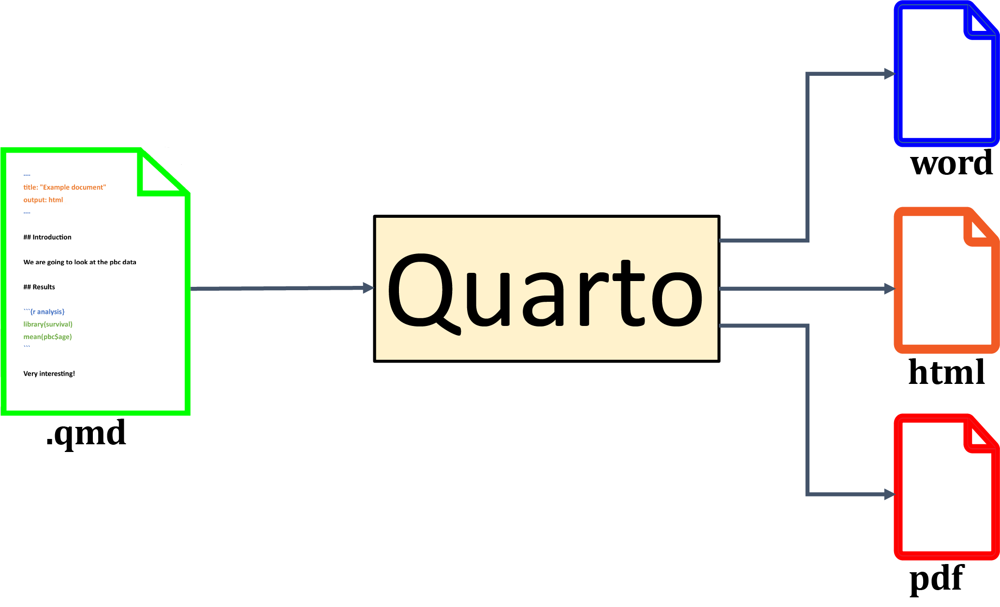
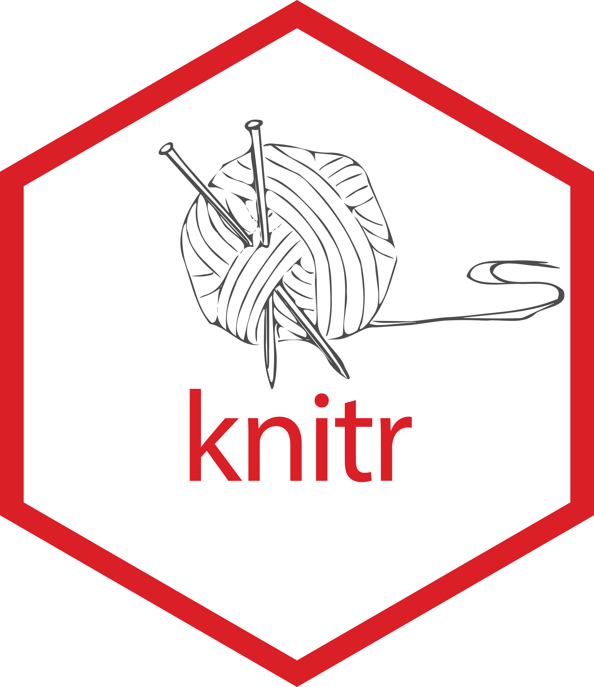
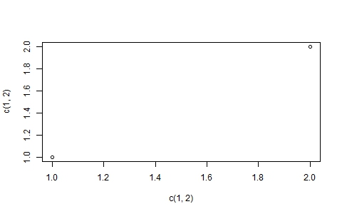
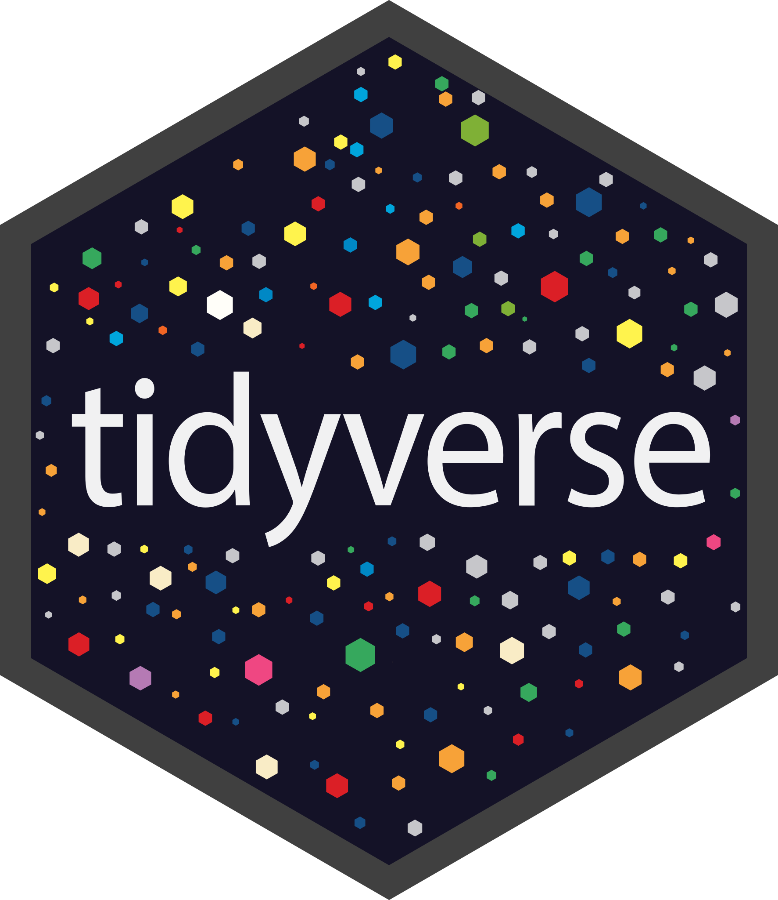

```{r setup, include=FALSE}

library(survival)
library(knitr)
library(kableExtra)
library(dplyr)


pbc <- survival::pbc
pbcseq <- survival::pbcseq
```

## R Course - Programme {data-background-image="./templateassets/lbback.svg" data-background-color="#86d2ed" .center}

```{css, echo=FALSE, include=FALSE}
<style>
    .red-cross {
      color: red;
    }
</style>
<style>
    .green-checkmark {
      color: green;
    }
</style>  

```


-   Day 1: Introduction
-   Day 2: Data management and Analysis
-   Day 3: Data visualisation and Functions
-   <b>Day 4: Additional topics</b>

## Program this morning

<br>

- Quarto 
- Shiny
- Tidyverse
- R in Erasmus MC


# Quarto {data-background-image="./templateassets/lbback.svg" data-background-color="#86d2ed" .center}

## Problems {.triangledb}

* When doing research, you often want to discuss things with collaborators (for example your supervisor)

* Results from R often need to be copied into Word or PowerPoint.
  - This often [**does not look good**]{color="#b281e2"} without formatting
  - [**Errors**]{color="#e84720"} can be introduced
  - Making small changes means you have to do everything again
  
* It is convenient to have code, output and documentation [**together**]{color="#afcc46"}
  
## Problem (2) {.triangledb}


* [**Authors**]{color="#e84720"} need to invest effort to create a [**aesthetically pleasing**]{color="#0c2074"} document (presentation, web, report)
* [**Readers**]{color="#afcc46"} who want to reproduce results may need to gather different files and puzzle out which results were produced by which code
* No single comprehensive document that integrates data analysis with documentation and discussion of results
  - **Data**, **Code**, **Documentation** and **Results** [**lack proper linkage**]{color="#e84720"}
* Hard to [**update**]{color="#AFA4F6"} analyses when there are small changes to data or methods

## Goals {.triangledb}

<br>
  
* We want our scientific documents to be:
  - [**Reproducible**]{color="#0c2074"}
  - [**Transparent**]{color="#0c2074"}
  - [**Shareable**]{color="#0c2074"}
  - [**Understandable**]{color="#0c2074"}
  - [**Efficient to produce and maintain**]{color="#0c2074"}
  
## Literate Programming {.triangledb}

* [**Origin of the concept:**]{color="#0c2074"} Don Knuth
* A document is a stream of [**text**]{color="#df4512"} and [**code** ("**chunks**")]{color="#afcc46"}
* Presentation code formats results (tables, figures)
* Text explains what is done
  - self-documenting
* Literate programs are [**woven**]{color="#b281e2"} to produce human-readable documents and [**tangled**]{color="#0078d1"} to produce machine-readable documents

## Two parts  {.triangledb}

<br>

* We need:

  - a [**documentation language**]{color="#e84720"}
    * To write and format the explanatory text

  - a [**programming language**]{color="#afcc46"}
    * To write the code for the analysis

## Quarto  {.triangledb}

* Quarto is a format for writing \alert{reproducible, dynamic reports}
* Keeps **code**, **output**, **documentation** and **results** [**together**]{color="#e84720"}
* Use it to [**embed R code and results**]{color="#0c2074"} into **various formats**

:::: {.columns}

::: {.column  style="background-color: #fafafa; width:55%;"}

{width="65%"}

:::

::: {.column style="background-color: #fafafa; width:10%;"}

:::

::: {.column  style="background-color: #fafafa; width:15%;"}

<br>
<br>

{style="width:60%;"}

:::

::::

## History {data-background-image="./_extensions/stenw/templateassets/triangledb-bg.svg" data-background-size="cover" data-background-position="top center" .smaller}
  
::: {.timeline}

<div class="side-by-side-container">
<div class="container left">

<div class="content">
<h5>2002: Sweave</h5>
<p>Friedrich Leish</p>
</div>
</div>
<div class="extrabox">


</div>
</div>
<div class="side-by-side-container">
<div class="extrabox">

</div>
<div class="container right2">
<div class="content">
<h5>2012: Knitr / rmarkdown </h5>
<p>by Yihui Xie</p>
</div>
</div>
</div>

<div class="side-by-side-container">

<div class="container left">

<div class="content">
<h5>2022: Quarto</h5>
<p>by Carlos Scheidegger et al.</p>
</div>
</div>

<div class="extrabox">

</div>

</div>
:::


## Formats {.triangledb}

* Quarto can produce output in [**various formats**]{color="#e84720"} such as:
  - [slideshows (e.g. PowerPoint)]{color="#0c2074"},
  - [PDFs]{color="#0c2074"},
  - [books]{color="#0c2074"},
  - [HTML documents]{color="#0c2074"},
  - [blogs]{color="#0c2074"},
  - [dashboards]{color="#0c2074"},
  - etc

## Markdown (cont'd) {.triangledb}

* In **RStudio**
   * File $\rightarrow$ New File $\rightarrow$ Quarto...
   * Insert title and author
   * Select format
* Write your `.qmd` file
* Click the **Render** button (or use `quarto render` on command line)
  
## Minimal Quarto document {.triangledb}




## Minimal Quarto document results {.triangledb}


   
## Advantages and disadvantages {.triangledb}

::: columns

:::: {.column width="47%"}

<h3>Advantages</h3>

* <span class="green-checkmark" style="color:MediumSeaGreen;">&#10004;&#xfe0e;</span> Everything in one place
* <span class="green-checkmark" style="color:MediumSeaGreen;">&#10004;
</span> Everything updates to reflect external changes
* <span class="green-checkmark" style="color:MediumSeaGreen;">&#10004;</span> Rebuilding the document functions as a "regression test"

::::

:::: {.column width="47%"}

<h3>Disadvantages</h3>

<p>
* ❌ When you put everything in a single document it may be difficult to read and edit
* ❌ May be slow
<br>
<br>
<br>
</p>
::::

:::   

## Visual editor {.triangledb}

* RStudio has a visual editor for Quarto

* Use CTRL-/ to insert a new structure (list, equation, image, etc)

* RStudio promises seamless switching between visual and source mode, but your mileage may vary
   
# Markdown basics {data-background-image="./templateassets/lbback.svg" data-background-color="#86d2ed" .center}
   

## Headers {.triangledb}

<br>

::: {.columns .equal-height}


:::: {.column width="47%"}

<h3>Code</h3>

```{.markdown}

# Results
## Primary Outcome
## Secondary outcomes

```
<br>

::::

:::: {.column width="47%"}

<h3>Output</h3>

<h4>Results</h4>
<h5><small>Primary Outcome</small></h5>
<h5><small>Secondary Outcomes</small></h5>
::::

:::

## Emphasis {.triangledb}

::: {.columns .equal-height}


:::: {.column width="47%"}

<h3>Code</h3>

```{.markdown code-line-numbers="false"}

*Methods*  
_Methods_
**Methods**
__Methods__

```


::::

:::: {.column width="47%"}

<h3>Output</h3>

*Methods*  
_Methods_<br>
**Methods**<br>
__Methods__<br>

::::

:::

## Bullets {.triangledb}

::: {.columns .equal-height}


:::: {.column width="47%"}

### Code 

```{.markdown code-line-numbers="false"}

* Method 1
- Method 2
+ Method 3

* Results
  * Method 1
  * Method 2


```

::::

:::: {.column width="47%"}

<h3>Output</h3>

* Method 1
- Method 2
+ Method 3

* Results
  * Method 1
  * Method 2

::::

:::

## Links {.triangledb}

::: {.columns .equal-height}


:::: {.column width="47%"}

<h3>Code</h3>

```{.markdown code-line-numbers="false"}

[link](https://example.com)

```

::::

:::: {.column width="47%"}

<h3>output</h3>

[link](https://example.com)

::::

:::

## Images {.triangledb}

::: {.columns .equal-height}


:::: {.column width="47%"}

<h3>Code</h3>

```{.markdown code-line-numbers="false"}


```

<small>Optionally attributes for width, height and alignment can be set (see documentation for details)</small>

```{.markdown code-line-numbers="false"}

{
				width=4cm}

```

::::

:::: {.column width="47%"}

<h3>output</h3>


 

::::

:::

::: aside

<small>More on plots below</small>

:::

## Tables {.triangledb}

::: {.columns .equal-height}

:::: {.column width="47%"}

<h3>Code</h3>

```{.markdown}

| Default | Left | Right | Center |
|---------|:-----|------:|:------:|
| 12      | 12   |    12 |   12   |
| 123     | 123  |   123 |  123   |
| 1       | 1    |     1 |   1    |

: Optional label

```

::::

:::: {.column width="47%"}

<h3>Output</h3>

<small>

::::: {.spwtable }

| Default | Left | Right | Center |
|---------|:-----|------:|:------:|
| 12      | 12   |    12 |   12   |
| 123     | 123  |   123 |  123   |
| 1       | 1    |     1 |   1    |

: Optional label

:::::

</small>

::::

:::

::: aside

<small>More on tables below</small>

:::

## Escaping {.triangledb}

::: {.columns .equal-height}


:::: {.column width="47%"}

<h3>Code</h3>

```{.markdown}

\*Method\*

```

::::

:::: {.column width="47%"}

<h3>Output</h3>

\*Method\*

::::

:::


Escaping Markdown characters with a backslash allows you to use characters that might otherwise be interpreted as Markdown, HTML, or TeX.

## Code {.triangledb}

::: {.columns .equal-height}


:::: {.column width="47%"}

<h3>Code</h3>

```{.markdown}

`Methods`

```

::::

:::: {.column width="47%"}

<h3>Output</h3>

`Methods`

::::

:::

## LaTeX equations {.triangledb}

::: {.smaller}

```{r}
#| echo: false
library(knitr)
library(tibble)

latex_reference <- tribble(
  ~Category, ~Syntax, ~Result,
  "Fractions", "`\\frac{a}{b}`", "$\\frac{a}{b}$",
  "Greek", "`\\alpha \\Omega`", "$\\alpha \\quad \\Omega$",
  "Square root", "`\\sqrt{x}`", "$\\sqrt{x}$",
  "Sum", "`\\sum_{i=1}^n`", "$\\sum_{i=1}^n$",
  "Product", "`\\prod_{i=1}^n`", "$\\prod_{i=1}^n$",
  "Integral", "`\\int_a^b`", "$\\int_a^b$",
  "Limit", "`\\lim_{x \\to \\infty}`", "$\\lim_{x \\to \\infty}$",
  "Bold", "`\\mathbf{x}`", "$\\mathbf{x}$",
  "Less or equal", "`x \\leq y`", "$x \\leq y$",
  "Greater or equal", "`x \\geq y`", "$x \\geq y$",
  "Element of", "`x \\in A`", "$x \\in A$",
  "Plus/minus", "`\\pm`", "$\\pm$",
  "Times", "`\\times`", "$\\times$",
  "Multiply dot", "`\\cdot`", "$\\cdot$"
)

half <- ceiling(nrow(latex_reference) / 2)
left <- latex_reference[1:half, ]
right <- latex_reference[(half + 1):nrow(latex_reference), ]
latex_reference_wide <- cbind(left, right)
names(latex_reference_wide) <- c("Category", "Syntax", "Result", "Category ", "Syntax ", "Result ")

# Print both tables
kable(
latex_reference_wide,
escape = FALSE
) 

```

:::

## References {.triangledb}

* A list of common Quarto and R Markdown commands can be found here:
- [R Markdown cheatsheet](https://www.rstudio.com/wp-content/uploads/2015/02/rmarkdown-cheatsheet.pdf)
- [rmarkdown.rstudio.com/authoring_basics.html](https://rmarkdown.rstudio.com/authoring_basics.html) and
- [quarto.org/docs/authoring/markdown-basics.html](https://quarto.org/docs/authoring/markdown-basics.html) (specifically for *quarto*)


## Code chunks {.triangledb}

* [**Quarto**]{color="#0c2074"} allows us to include [**code blocks**]{color="#b281e2"}
* They are surrounded by three backticks (```)
* The header is surrounded by curly braces and specifies the language (e.g. `r` )
  * r is the default, but other languages are also supported (e.g. python, julia, etc)
* They will be executed during rendering

## Code chunks (cont'd) {.triangledb}


::: columns


:::: {.column width="47%"}

<h3>Code</h3>

````{.r code-line-numbers="false"}
```{{r }}
1+1
```
````

Optionally use a label:

````{.r code-line-numbers="false"}
```{{r}}
label: oneplusone
1+1
```
````

or

````{.r code-line-numbers="false"}
```{{r oneplusone}}
1+1
```
````

::::

:::: {.column width="47%"}

<h3>Output</h3>

```{r }
1+1
```

<br>

* Note: inline R can be included using something like ``{r} NROW(x)``

::::

:::


## Plots  {.triangledb}

* Plots that are produced in an R code chunk are included in the document

::: {.columns .equal-height}


:::: {.column width="47%"}

<h3>Code</h3>

````{.r code-line-numbers="false"}

```

plot(x=c(1, 2),
     y=c(1, 2))
     

```


````

::::

:::: {.column width="47%"}

<h3>Output</h3>

```{r}
plot(x=c(1, 2),
     y=c(1, 2))
```

::::

:::

## Plots (continued)  {.triangledb .smaller}

* Sometimes it can be useful to save the plot to file and then include it in the document using Quarto

::: {.columns .equal-height}


:::: {.column width="47%"}

<h3>Code</h3>

````{.r code-line-numbers="false"}

```
jpeg("example.jpg")
plot(x=c(1, 2),
     y=c(1, 2))
dev.off()     

```



````

::::

:::: {.column width="47%"}

<h3>Output</h3>

```{r include=FALSE}
jpeg("example.jpg", height=300, quality= 99)
plot(x=c(1, 2),
     y=c(1, 2))
dev.off()     
```


::::

:::

## Tables  {.triangledb .smaller}

* Above we showed how to create Markdown-based tables
* Sometimes we want to use R.
* Use the `kable` function to display tables nicely 

::: {.columns .equal-height}


:::: {.column width="47%"}

<h3>Code</h3>

````{.r code-line-numbers="false"}

```

knitr::kable(data.frame(a=c(1,2),
  b=c(3,4)))
     

```


````

::::

:::: {.column width="47%"}

<h3>Output</h3>

```{r}
knitr::kable(data.frame(a=c(1,2),
  b=c(3,4))) |> 
  kable_styling(full_width = TRUE, htmltable_class = "spwtable")

```

::::

:::

<small>The `flextable` and `kableExtra` packages can also be useful</small>


## Chunk options {.triangledb}

<br>

* Code chunks can have various options
* Options can be set as a comma-separated list of `key=value` pairs in the chunk header
* In Quarto, they can also be set using `#|` followed by `key: value` pairs
  - [NB: When using `#|` comments, use `true` and `false` instead of `TRUE` and `FALSE`]{color="#df4512"}


## Chunk options (cont'd) {.triangledb .smaller}


| Option           | Run code | Show code | Output | Plots | Messages | Warnings |
|------------------|:--------:|:---------:|:------:|:-----:|:--------:|:--------:|
| `eval: false`    |    X     |           |   X    |   X   |    X     |    X     |
| `include: false` |          |     X     |   X    |   X   |    X     |    X     |
| `echo: false`    |          |     X     |        |       |          |          |
| `results: hide`  |          |           |   X    |       |          |          |
| `fig-show: hide` |          |           |        |   X   |          |          |
| `message: false` |          |           |        |       |    X     |          |
| `warning: false` |          |           |        |       |          |    X     |

<br>

* R for data science Hadley


## Chunk options (cont'd) {.triangledb}

*  **results**: If `hide`, results are not shown. If `hold`, knitr will delay displaying all output until the end of the chunk. If `asis`, knitr will pass through results without reformatting them (useful if results return raw HTML, etc.)
* **error**: If `TRUE`, rendering will continue after an error and the error message will be included in the output.
*	**cache**: If `TRUE`, quarto will cache the results to reuse in future knits. Quarto will reuse the results until the code chunk is altered.
* **cache.comments**: If `FALSE`, quarto will not rerun the chunk if only a code comment has changed


## Chunk options (cont'd) {.triangledb}

* **fig.cap**: A character string to be used as a figure caption in HTML
*	 **fig.height**, **fig.width**: The width and height to use in R for plots created by the chunk (in inches)
*  **out.height**, **out.width**: The width and height of plots as they are included in the document (in px or percentages (for html output))
* **fig-format** : The format to use for plots (e.g. `png`, `jpg`, `pdf` etc)

## R Markdown Gallery {.triangledb}

```{=html}
<iframe  height="80%" width="95%" src="https://rmarkdown.rstudio.com/gallery.html" title="R Markdown Gallery"></iframe>
```


## YAML header  {.triangledb}

* **YAML:** YAML Ain't Markup Language

* A YAML header contains YAML **keywords**, such as “title”, “author”, and “date”
* preceded and ended by three dashes (—)

```{.r}
---
title: "R course - Day 4"
subtitle: Introduction
author: Sten Willemsen
date: "16 November 2023"
---

```

* Converted to title, author, etc in document
* Receives formatting

## YAML header (2)  {.triangledb}

* Also used to set various options
  * [**format**]{color="#e84720"} of output
  * [**Themes**]{color="#e84720"} and [**templates**]{color="#e84720"}
  * Inclusion of TOC (table-of-contents)
  * Set execution options for code chunks globally
  * etc

## Popular Output formats {.triangledb}

::: {.spwtable }

| **Output Type**         | **Quarto Format**            | 
|--------------------------|------------------------------|
| HTML Document           | `format: html`              | 
| PDF Document            | `format: pdf`               | 
| Word Document           | `format: docx`              | 
| Reveal.js Presentation  | `format: revealjs`          | 
| Beamer Presentation     | `format: beamer`            |

:::

## Spin {data-background-image="./_extensions/stenw/templateassets/triangledb-cap.svg" data-background-size="cover" data-background-position="top center"}

* We normally use Quarto to transform `.qmd` files into documents

* We can also transform special R scripts into `.qmd` files (and then into HTML, PDF, and so on)
  - This is called [**spinning**]{color="#DB3324"}

* All **normal text** should be written after a `#'` comment

* Code is split in chunks by markdown content

* **Code chunk** options are preceded by `#|`

* See the demos from the first day as examples

## Spin: example {.triangledb}




* See the demos from the first day as examples


## If you want to know more {.triangledb}

::: {layout-ncol=2}

[{fig-alt="Cover of R Markdown: The Definitive Guide" width=62%}](https://bookdown.org/yihui/rmarkdown/)

[{fig-alt="Cover of R Markdown Cookbook" width=63%}](https://bookdown.org/yihui/rmarkdown-cookbook/)

:::

# Shiny {data-background-image="./templateassets/lbback.svg" data-background-color="#86d2ed" .center}

## Introduction {.triangledb}

* Shiny is an R package that makes it easy to build [**interactive web apps**]{color="#e84720"} straight from **R**
* Shiny combines the computational power of \R with the interactivity of the modern web
* Shiny apps are easy to write - No web development skills are required

<br>

{.absolute top=50% left=50% width="100"}


## Shiny in RStudio {.triangledb}

* File $\rightarrow$ New File $\rightarrow$ Shiny Web App...
* Insert application name and location
* Let's try an example to see it work
* Modify step-by-step

## Structure  {.triangledb}

* Shiny applications consist of:
	* a user interface object (`ui`): the layout and appearance of your app
	* a `server` function: the instructions your computer needs to build your app
	* a call to `shinyApp()`: this creates the app object

## Structure in code {.triangledb}

```{.r}
library(shiny)

# Define UI ----
 ui <- fluidPage(
)
				
# Define server logic ----
 server <- function(input, output) {
}
				
# Run the app ----
shinyApp(ui = ui, server = server)

```

## User Interface {.triangledb}

* Consists of a **layout function** that defines the layout of the app
  * `fluidPage()`, `fillPage()`, `fixedPage()`, etc  
* Further layout functions can further structure the layout:
  * `sidebarLayout`, `sidebarPanel`, `mainPanel`, etc

## User Interface (2) {.triangledb}

* The interface may contain various elements to display different things to the user

* `titlePanel("Old Faithful Geyser Data")`

* [**input**]{color="#e84720"} controls
```{.r}
            sliderInput("bins",
                        "Number of bins:",
                        min = 1, max = 50, value = 30)
```

* [**Output**]{color="#afcc46"}:

```{.r}
plotOutput("distPlot")
```

## Common Shiny Inputs {.triangledb}

* `sliderInput()` - slider for numeric values
* `textInput()` - text entry field
* `selectInput()` - dropdown menu
* `checkboxInput()` - single checkbox
* `radioButtons()` - radio button group
* `dateInput()` - date picker
* `fileInput()` - file upload

## Common Shiny Outputs {.triangledb}

* `plotOutput()` + `renderPlot()` - for plots
* `tableOutput()` + `renderTable()` - for tables
* `textOutput()` + `renderText()` - for text
* `verbatimTextOutput()` + `renderPrint()` - for code output
* `uiOutput()` + `renderUI()` - for dynamic UI
  
## Server function {.triangledb}

* It specifies how the [**output**]{color="#afcc46"} should be calculated based on the [**inputs**]{color="#e84720"}


```{.r}
    output$distPlot <- renderPlot({
        x    <- faithful[, 2]
        bins <- seq(min(x), max(x), length.out = input$bins + 1)
        hist(x, breaks = bins, col = 'darkgray', border = 'white',
             xlab = 'Waiting time to next eruption (in mins)',
             main = 'Histogram of waiting times')
    })
```

* Uses different **render** functions


# Tidyverse {data-background-image="./templateassets/lbback.svg" data-background-color="#86d2ed" .center}


## What is the tidyverse {.triangledb}

<br>

* **Collection of packages** from the same team that created RStudio
* It duplicates some functionality from base R
* [**Consistent**]{color="#e84720"} and [**designed to work together**]{color="#afcc46"}
* Often more intuitive

{.absolute left=50% width="128"}

::: aside

There are also disadvantages to the tidyverse. For example it is less stable in the sense that it develops faster

:::


## Tidyverse packages{.triangledb .smaller}


:::{.emcdescriptionlist}

tibble
: Replacement for `data.frame`s

dplyr
:  Grammar of data manipulation (`select`, `filter`, `mutate`, `summarise`, `arrange`)

tidyr
: Tidy messy data (also lets you pivot data)

ggplot2
: Replacement for base plots. Discussed before

readr
: Import data

purrr
: Tools for functional programming

forcats
: Tools for categorical data

stringr
: Tools for character data


:::

::: aside

There are many more packages that, although not formally part of the tidyverse, follow the same design principles

:::

## Pipe operation {.triangledb}

* Pipe operator in tidyverse is `%>%`
* Takes the [**output**]{color="#afcc46"} of a function on the left-hand-side 
* Uses it as [**input**]{color="#e84720"} for a function on the right
  - by default as the first argument
* It often makes long sequences of transformations more readable.
<br>
* Now also included in base R `|`<wbr>`>` (sometimes rendered as `|>`)

## Pipe operation (cont'd) {.triangledb .smaller }

* Nested functions - hard to read:

```{r echo=TRUE}
#| eval: false
# Without pipe - hard to read
mean(log(abs(c(-5, -2, 3, 7))))
```


* Using a pipe - reads left to right:

```{r echo=TRUE}
#| eval: false
c(-5, -2, 3, 7) %>% 
  abs() %>% 
  log() %>% 
  mean()
```

* Base R syntax can be made shorter by nesting expressions
* Does not help readability


## Tibble {.triangledb}

* The tibble package introduces the `tibble`, a replacement for the `data.frame`

* Does not print all rows and columns by default

* Shows column types when printed

* Mostly works like a `data.frame`, but if you get a strange error you can convert it using `as.data.frame.tbl_df`

## dplyr {.triangledb}

* Key functions:
  * `select`
  * `filter`
  * `group_by`
  * `summarise`
  * `arrange`
  
::: aside

See [dplyr cheatsheet](https://github.com/rstudio/cheatsheets/blob/main/data-transformation.pdf)

:::

## Example {.triangledb .smaller}

**Task:** Analyze survival by treatment and bilirubin level for patients over 40

```{r echo=TRUE}
#| eval: false
pbc_sub <- pbc[!is.na(pbc$trt) & pbc$age > 40, 
               c("id", "time", "age", "sex", "trt", "bili")]
pbc_sub$bili_cat <- ifelse(pbc_sub$bili > 2, "High", "Normal")
pbc_sub$time_years <- pbc_sub$time / 365.25
result <- aggregate(cbind(mean_time = time_years, mean_age = age) ~ 
                    sex + trt + bili_cat, data = pbc_sub, FUN = mean)
counts <- aggregate(id ~ sex + trt + bili_cat, data = pbc_sub, FUN = length)
names(counts)[4] <- "n_patients"
result <- merge(result, counts, by = c("sex", "trt", "bili_cat"))
result[order(-result$mean_time), ]

```

<br>

* Base R syntax can be made shorter by nesting expressions
* Does not help readability


## Example (cont'd) {.triangledb .smaller}


```{r echo=TRUE}
#| eval: false
pbc %>% 
  filter(!is.na(trt), age > 40) %>% 
  select(id, time, age, sex, trt, bili) %>% 
  mutate(bili_cat = if_else(bili > 2, "High", "Normal"),
         time_years = time / 365.25) %>% 
  group_by(sex, trt, bili_cat) %>% 
  summarise(n_patients = n(),
            mean_time = mean(time_years, na.rm = TRUE),
            mean_age = mean(age, na.rm = TRUE),
            .groups = "drop") %>% 
  arrange(desc(mean_time))

```

<br>

::: {.boxspw}

* The pipe operator makes the code more **readable**

:::

## Next Steps {.triangledb}

<br>

- [tidyverse.org](https://www.tidyverse.org/) - Official site
- [R for Data Science](https://r4ds.hadley.nz/) - Free online book

# R in Erasmus MC {data-background-image="./templateassets/lbback.svg" data-background-color="#86d2ed" .center}


## Local installation {.triangledb}

<br>

* Most [**flexible**]{color="#e84720"}

<br>

* Does not make IT happy 😒


## Central Installation {.triangledb}  
  
* Go to **Service portal** and search for **RStudio**
* You will find a form to request addition to the **R-users group**
* Employees of several departments / groups are added automatically 
* Available in `mijnwerkplek.erasmusmc.nl`
  
## Packages {.triangledb}

* By default, packages are saved in 'My Documents'
* This has very [**limited space**]{color="#e84720"}
* If you use the central installation, you gain access to a network drive `p:` which has many packages pre-installed
* You can **choose location** using `.libPaths()` function
* You can make this **permanent** by using `.Renviron` file
```{verbatim rlibs}
#| code-line-numbers: false
R_LIBS_USER=v:/homedir/959750/tools/Rlibs/%p%V-library/%v
```


## Digital Research Environment (DRE) {.triangledb}

* DRE runs on virtual machines using [**Microsoft Azure**]{color="#e84720"}
* Configured data management, processing, and sharing can be done securely
* Various computational tools (including R and RStudio) can be used
* Collaboration with external parties is possible
* More computational power is available when needed
* See [https://andrea-cloud.com/](https://andrea-cloud.com/) and [support.mydre.org](https://support.mydre.org)


## The End / Questions? {.closing-slide data-background-image="./templateassets/lbback.svg" data-background-color="#86d2ed"}

**Keep practicing! The best way to learn R is to use it on real problems.**

